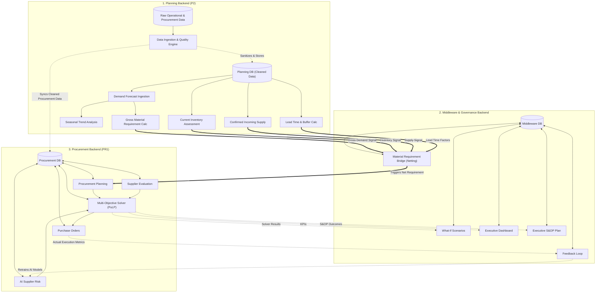

# Cognizant Planning & Procurement: Architectural Workflow

Based on the architectural requirements, the system is explicitly divided into three distinct backends, each with its own dedicated database. 

1. **Planning System (P2)**: Handles raw data ingestion, sanitization, demand forecasting, and supply capacity planning.
2. **Middleware & Governance**: Acts as the central orchestrator, bridging P2 and PR1, and providing governance, scenario testing, and executive reporting features.
3. **Procurement System (PR1)**: Handles vendor intelligence, risk prediction, and purchase order optimization.

---

## Consolidated End-to-End Architecture Diagram

---

## Detailed Step-by-Step Breakdown

### 1. Planning Backend (P2)
*A standalone backend focused on establishing the data foundation and executing core planning steps.*
- **Data Ingestion & Quality:** Serves as the primary entry point for all raw data. Cleanses, sanitizes, and stores the foundational data in the Planning DB.
- **Demand Planning:** Analyzes S&OP forecasts to calculate gross material requirements based on production needs and seasonal trends.
- **Supply Planning:** Manages internal manufacturing buffers by assessing current inventory, confirmed incoming supply, and lead time buffers.

### 2. Middleware & Governance Backend
*This backend connects the isolated Planning and Procurement systems. It processes the bridge calculations and powers executive dashboards.*
- **Material Requirement (P2 → PR1 Bridge):** Acts as the critical connected middleware. It calculates the actual net procurement requirement by evaluating P2's Demand/Supply signals (Gross - Inventory - Confirmed Supply = Net Requirement) and pushing it to PR1.
- **What-If Scenarios:** Allows users to inject hypothetical disruptions into the PR1 optimization engine.
- **Feedback Loop:** Captures historical execution metrics from PR1 and feeds them back into the PR1 AI.
- **Executive Dashboard & Executive S&OP Plan:** High-level narrative engines and KPI aggregations reading across the entire platform.

### 3. Procurement Backend (PR1)
*A standalone backend with its own database focused on intelligent sourcing and execution.*
- **Procurement Planning:** Receives the net material requirement from the middleware and prepares procurement parameters.
- **Supplier Evaluation:** Scores vendors based on static metrics (Quality, Delivery, Capacity).
- **AI Supplier Risk:** Uses machine learning models to predict vendor disruption probability.
- **Multi-Objective Solver:** The mathematical engine (PuLP) that allocates purchase orders across suppliers to minimize cost and risk.
- **Purchase Orders:** Generates the final execution artifacts for the ERP system.
