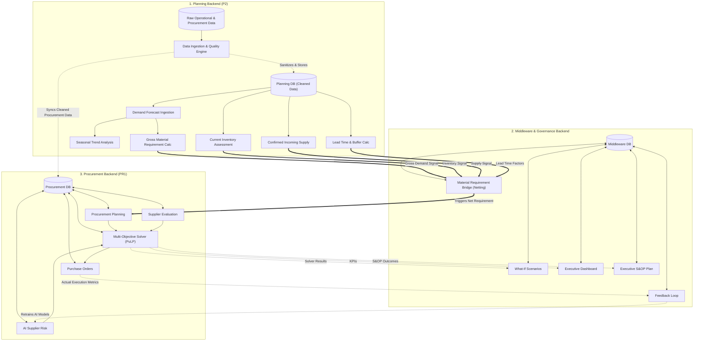

# WORKFLOW.md

# Cognizant Planning & Procurement: Architectural Workflow

Based on the architectural requirements, the system is explicitly divided into three distinct backends, each with its own dedicated database. 

1. **Planning System (P2)**: Handles raw data ingestion, sanitization, demand forecasting, and supply capacity planning.
2. **Middleware & Governance**: Acts as the central orchestrator, bridging P2 and PR1, and providing governance, scenario testing, and executive reporting features.
3. **Procurement System (PR1)**: Handles vendor intelligence, risk prediction, and purchase order optimization.

---

## Consolidated End-to-End Architecture Diagram

---

## Detailed Step-by-Step Breakdown

### 1. Planning Backend (P2)
*A standalone backend focused on establishing the data foundation and executing core planning steps.*
- **Data Ingestion & Quality:** Serves as the primary entry point for all raw data. Cleanses, sanitizes, and stores the foundational data in the Planning DB.
- **Demand Planning:** Analyzes S&OP forecasts to calculate gross material requirements based on production needs and seasonal trends.
- **Supply Planning:** Manages internal manufacturing buffers by assessing current inventory, confirmed incoming supply, and lead time buffers.

### 2. Middleware & Governance Backend
*This backend connects the isolated Planning and Procurement systems. It processes the bridge calculations and powers executive dashboards.*
- **Material Requirement (P2 → PR1 Bridge):** Acts as the critical connected middleware. It calculates the actual net procurement requirement by evaluating P2's Demand/Supply signals (Gross - Inventory - Confirmed Supply = Net Requirement) and pushing it to PR1.
- **What-If Scenarios:** Allows users to inject hypothetical disruptions into the PR1 optimization engine.
- **Feedback Loop:** Captures historical execution metrics from PR1 and feeds them back into the PR1 AI.
- **Executive Dashboard & Executive S&OP Plan:** High-level narrative engines and KPI aggregations reading across the entire platform.

### 3. Procurement Backend (PR1)
*A standalone backend with its own database focused on intelligent sourcing and execution.*
- **Procurement Planning:** Receives the net material requirement from the middleware and prepares procurement parameters.
- **Supplier Evaluation:** Scores vendors based on static metrics (Quality, Delivery, Capacity).
- **AI Supplier Risk:** Uses machine learning models to predict vendor disruption probability.
- **Multi-Objective Solver:** The mathematical engine (PuLP) that allocates purchase orders across suppliers to minimize cost and risk.
- **Purchase Orders:** Generates the final execution artifacts for the ERP system.

# architect_script.md

# Architect's Script: Deep Dive into Pages 6-13

This script is designed for the systems architect portion of the presentation. It focuses heavily on the "hows" of the system, breaking down complex data flows and machine learning concepts into engaging, easy-to-understand language.

---

### Page 6: Architecture - Supply & Operation Planning (The Foundation)
**"Let's pull back the curtain and look at the engine driving this platform. We'll start with the Planning Backend. Think of this as the brain that understands what the market wants versus what we actually have.** 

**We built this logic in our custom `DemandSignalEngine`. We ingest massive historical datasets—`demand_forecast.csv`, `material_master.csv`, and `lead_time.csv`—and push them through a rigorous Data Quality Engine.** 

**Once the data is clean, we calculate the foundational formula. We take the 'Gross Material Requirement', and programmatically subtract our 'Current Inventory' and 'Confirmed Incoming Supply' (what's already on the boats).** 

**The output is the 'Net Procurement Requirement'. This is our foundational truth. It tells us exactly what materials the business needs to survive and thrive, mathematically."**

---

### Page 7: Phase 1 - Smart Demand Forecasting & S&OP Planning
**"This takes us into Phase 1: Smart Demand Forecasting. A traditional supply chain looks at last year's sales, adds 10%, and calls it a day. We don't do that.**

**Our system ingests massive amounts of historical data to establish baseline predictions across our plants—from the Tirupur Apparel Hub to Vietnam Garment Tech.**

**But the most important output here is the 'Unconstrained View'. Before we worry about factory limits or shipping delays, we show our executives the pure, raw market demand. Why? Because if you only plan for what you *can* build, you'll never know what you *could* have sold. This unconstrained view drives much sharper strategic planning across the board."**

---

### Page 8: Phase 2 - Material Requirements Intel & BOM Explosion
**"Once we know what we need to sell—let's say 72,000 jackets—we move to Phase 2. This isn't just about ordering finished jackets; it's about the microscopic details.**

**We perform a 'BOM Explosion'—a Bill of Materials breakdown. The system takes that jacket and programmatically shreds it into its components: 1.6 meters of blue outer fabric, 1.2 meters of white lining, 1 zipper, 5 buttons.**

**Then, we do something called 'Inventory Netting'. The system automatically looks at what we already hold in the warehouse and what is currently in transit, and subtracts it from the gross requirement.** 

**We don't buy 72,000 zippers if we already have 18,000 on a shelf and 10,000 on a truck. We generate a precise *Net Procurement Requirement*. This completely eliminates 'just-in-case' over-ordering and drastically cuts our excess inventory costs."**

---

### Page 9: Architecture - Middleware Backend (The Orchestrator)
**"So, Planning knows exactly what we need down to the last button. How do we buy it intelligently? Enter our Middleware Backend.**

**This is the central nervous system of our platform. It sits right between Planning (P2) and Procurement (PR1). It takes that net requirement we just calculated and passes it through a strict governance layer.**

**This is where we run What-If Scenarios and bridge the gap. It asks: 'Before we send this to Procurement, does this align with our executive KPIs?' It acts as an intelligent translator, converting pure planning math into procurement-ready signals."**

---

### Page 10: Architecture - Procurement Planning & Supplier Risk (The Engine Room)
**"Now we hand the baton to the Procurement Backend. We built this entirely on FastAPI, meaning we expose high-speed endpoints like `/api/optimize-allocation` and `/api/simulate-scenario` that handle complex, asynchronous operations instantly.**

**This backend doesn't just generate purchase orders. It is a living, breathing engine. It runs our `AIRiskPredictionEngine` in the background to detect supplier risk. It uses our `MultiObjectiveAllocationEngine` to balance cost against reliability. And crucially, it has a self-learning loop via our `/api/feedback-loop/recalibrate` endpoint. Every time a supplier delivers late, the system learns, instantly retraining the models and adjusting future risk profiles."**

---

### Page 11: Phase 3 - AI-Driven Supplier Risk Identification (XGBoost / Gradient Boosting)
**"Let's dive into Phase 3 and talk about how that AI actually works. Under the hood, we are training a `GradientBoostingClassifier` to predict disruption probability, and a `RandomForestRegressor` to predict exact delay weeks.**

**Instead of relying on a buyer's 'gut feeling', our ML model ingests delivery and quality telemetry. It evaluates 8 precise features: on-time rate, average delay days, lead time variability, defect rate, disruption count, capacity utilization, financial score, and ESG score.**

**It processes all of this and assigns every supplier a real-time risk probability score between 0 and 100%. If you look at our outlier detection chart, the value becomes incredibly clear. A supplier might offer the cheapest price per unit, but the AI highlights them in red because there's an 85% chance they will disrupt our supply chain. We spot the 'cheap-but-risky' suppliers instantly."**

---

### Page 12: Phase 4 - Multi-Objective Supplier Allocation (PuLP Engine)
**"Now that we know the risk, how do we split the orders? This is Phase 4, and as an architect, this is my favorite part of the system. We use a PuLP Optimization Engine running the CBC Branch-and-Cut solver to handle a massive, multi-variable math problem.**

**We feed the engine the maximum capacities of our suppliers, their unit prices, the AI risk scores we just calculated, and strict contract constraints.**

**The objective function? Minimize total effective cost. But cost isn't just the invoice price. The solver mathematically minimizes: (Unit Price) + (Risk Penalty) + (Delay Penalty) + (Quality Penalty).**

**The engine crunches these continuous variables and outputs a mathematically guaranteed optimal allocation. For instance, instead of giving all 100,000 units to one risky supplier, it caps maximum supplier dependency at 60%, allocating the rest to a safer secondary supplier. It balances price and safety perfectly, taking human bias entirely out of the equation."**

---

### Page 13: Phase 5 - Automated Purchase Order Execution
**"Finally, Phase 5: From Math to Reality.**

**We don't just leave this as a theoretical pie chart. The optimized allocation from the PuLP engine is pushed to an Executive Review Dashboard via our `/api/dashboard` endpoint. Our human buyers remain in the loop—they review the total demand, the estimated cost, and the average risk score of the plan.**

**Once they review the AI's logic and are satisfied, they click 'Approve'.**

**Instantly, our `PurchaseOrderEngine` takes over. It generates exact, formatted Purchase Orders and exposes an export endpoint that can push directly into enterprise ERP systems—like SAP or Oracle—via secure APIs. We go from a raw demand signal to optimized, risk-aware purchase orders in a seamless, fully integrated flow."**

---

### Delivery Advice for the Architect Role:
- **Use Your Hands:** When talking about the "Middleware Backend" (Page 9), use your hands to show bringing two sides (Planning and Procurement) together. 
- **Emphasize the "Why":** Don't just say "we use XGBoost." Emphasize *why* (to eliminate gut feelings and spot cheap-but-risky suppliers).
- **Pacing on Page 12:** The PuLP Optimization slide is heavy. Slow down when listing the inputs (capacity, price, risk score, MOQ) so the audience realizes how complex the math is that the engine is solving for them instantly.

# judge_questions_prep.md

# Judge Q&A Preparation Guide

During your presentation, judges will test your understanding of both the **business (Supply Chain)** logic and the **engineering (Technical)** implementation. 

This document provides the most likely questions they will ask, along with strong, confident answers designed for a Team Leader and Systems Architect.

---

## 🏗️ Technical & Architecture Questions

### 1. Why did you choose FastAPI for the backend instead of Flask or Django?
**The Trap:** They want to see if you just picked a random framework or if there was an architectural reason.
**Your Answer:** 
> "We chose FastAPI specifically for its asynchronous processing capabilities and speed. Supply chain optimization—specifically running PuLP Linear Programming and XGBoost ML models simultaneously—is computationally heavy. FastAPI allows us to handle these concurrent operations without blocking the main thread, making our 'What-If' scenario recalculations almost instant."

### 2. Why use XGBoost / Gradient Boosting for Risk Prediction instead of Deep Learning / Neural Networks?
**The Trap:** Buzzword checking. Neural networks sound cool, but are bad for this specific task.
**Your Answer:**
> "Neural networks are great for images and text, but for structured, tabular supply chain data (like delivery times, defect rates, and capacities), tree-based models like XGBoost and Gradient Boosting mathematically outperform them. More importantly, XGBoost gives us *Feature Importance*—meaning we can explain exactly *why* the AI flagged a supplier as risky. In enterprise procurement, you can't rely on a 'black box'; buyers need to know the 'why'."

### 3. How does your PuLP Optimization Engine actually work? Why not just write a script that sorts suppliers by price?
**The Trap:** Checking if you understand Linear Programming vs. simple heuristics (greedy algorithms).
**Your Answer:**
> "A simple sorting script falls into the 'cheapest supplier trap.' It might buy everything from the cheapest supplier, completely ignoring the fact that they have an 80% risk of disruption. 
> Our PuLP engine runs a Mixed-Integer Linear Programming solver. Our objective function mathematically minimizes: **(Unit Price) + (Risk Penalty) + (Delay Penalty) + (Quality Penalty)**. It guarantees the mathematically optimal split across multiple suppliers while strictly adhering to capacity limits and Minimum Order Quantities (MOQs)."

### 4. How are you handling Data Quality and missing data? 
*(Referencing your Phase 1 Architecture)*
**The Trap:** Real enterprise data is always messy. They want to know your system doesn't crash on bad data.
**Your Answer:**
> "We built a dedicated Pandas preprocessing pipeline that runs upon data ingestion. It handles duplicates, but more importantly, it handles missing continuous variables using **Median Imputation**. For example, if a supplier is missing a financial stability score, the system injects the dataset median so the ML models don't crash on a `null` value. It ensures mathematical continuity."

---

## 📦 Supply Chain & Business Logic Questions

### 5. What exactly is NPR and why is it the core of your platform?
**The Trap:** Testing your fundamental supply chain knowledge.
**Your Answer:**
> "NPR stands for **Net Procurement Requirement**. It's the formula that keeps a company from going bankrupt due to excess inventory. 
> `NPR = Gross Material Requirement - Current Inventory - Confirmed Incoming Supply`. 
> Our system calculates this precisely. By netting out what we already hold in the warehouse and what's currently on ships, we only spend capital on what we *strictly* need."

### 6. Why use a simple Gaussian Distribution for baseline demand instead of an AI model?
**The Trap:** Testing if you know when *not* to use AI.
**Your Answer:**
> "We use AI heavily for Risk Prediction, but for baseline demand of established products, real-world supply chains follow standard normal (Gaussian) distributions. Using a highly complex AI for baseline demand often leads to 'overfitting'—where the model chases random market noise. Gaussian distribution gives us a highly stable, mathematically proven baseline that we then adjust with our seasonal multipliers. It's about using the right mathematical tool for the right job."

### 7. How does this platform handle the "Cheapest Supplier Trap"?
**The Trap:** Checking the business value of your optimization engine.
**Your Answer:**
> "The cheapest supplier trap happens when procurement buys solely on invoice price, but ends up paying millions in expedited air-freight when that cheap supplier delays the shipment. 
> We solve this by calculating the **Total Landed Risk-Adjusted Cost**. If Supplier B is $2 cheaper per unit, but our XGBoost model flags them with an 85% disruption probability, our PuLP solver applies a mathematical penalty to their cost. The engine will automatically reallocate the volume to a slightly more expensive, but highly reliable Supplier A, saving the business money in the long run."

### 8. What happens if a massive disruption occurs—like a port strike or typhoon?
**The Trap:** Testing the agility of the system.
**Your Answer:**
> "Traditional supply chains take days or weeks of spreadsheet math to recover from a massive disruption. In our platform, a planner simply opens the **What-If Scenario Simulation**. They input that the primary supplier's capacity just dropped by 80%. Our FastAPI backend instantly feeds this new constraint into the PuLP solver, which recalculates the entire global allocation and spits out the most cost-effective backup plan in seconds."

---

### 💡 General Tips for Answering:
1. **Don't Be Afraid of the Math:** If they ask a tough question, fall back on the math. Remind them that the system relies on statistical formulas and linear programming, not just "magic AI."
2. **"Yes, and...":** If a judge points out a flaw (e.g., "What about sudden viral trends?"), agree with them and point to the future roadmap. *"That's a great point. Currently, we use Gaussian baselines and seasonal multipliers, but addressing viral trends is exactly why we have GenAI integration and IoT tracking on our Future Roadmap."*

# presentation_roadmap.md

# End-to-End Platform Roadmap: AI-Driven S&OP and Procurement

This document outlines the step-by-step flow of the prototype. Use this as your "script" or roadmap when presenting the architecture to stakeholders. It contains technical breakdowns, AI definitions, and practical examples for each phase.

---

## 🏗️ Phase 1: Foundation (Data Ingestion & Integrity)
**Goal:** Ensure the mathematical engines and ML models are fed with clean, reliable data.

1. **Multi-Source Ingestion (Layer 1):** 
   - The platform ingests 13 disparate datasets (CSV feeds) covering everything from historical retail demand and product margins to supplier lead times, plant capacities, and historical delivery logs.
2. **Automated Data Cleaning (Stage 00):** 
   - Raw data is rarely perfect. The engine automatically runs an integrity audit. 
   - **Operations performed:** Drops duplicate records, imputes missing values, and filters out extreme mathematical outliers using IQR techniques.
   > **💡 Example:** If a supplier's "Financial Stability Score" is blank in the raw feed, the system automatically imputes (fills in) the median score of 80 to keep the AI models running smoothly.

---

## 📈 Phase 2: Demand Intelligence
**Goal:** Figure out exactly how much raw material we actually need, based on reality, not flawed historical data.

3. **Censored Demand Unconstraining (Layer 2):**
   - **The Problem:** Historical sales data is flawed by stockouts (the "under-forecasting trap").
   - **The Solution (Mathematical Reconstruction):** When a product hits `0` inventory (stockout), sales drop to `0`. The engine identifies these stockout periods and mathematically reconstructs the "True Latent Demand." It calculates what the sales *would have been* using a localized rolling average of non-stockout days, modulated by 52-week seasonality multipliers and promotional indices.
   > **💡 Example:** We ran out of Winter Jackets on Wednesday. The raw data says we sold `0` on Thursday and Friday. Instead of forecasting `0` for next year, the Unconstraining Engine reconstructs those days to show `250` units of demand, saving us from under-ordering next season.

4. **Material Requirements Planning (Layer 3):**
   - The unconstrained demand is translated into a **Gross Material Requirement**.
   - The system applies the core MRP formula: `Net Requirement = Gross Requirement - Current Factory Inventory - Confirmed Incoming Supply`.

---

## 🧠 Phase 3: AI Supplier Risk Prediction
**Goal:** Evaluate which suppliers are safe to use before we assign them millions of dollars in orders.

5. **Machine Learning Evaluation (Layer 4):**
   - The engine utilizes a **Dual-Model AI Architecture**:
     - **Model 1: Gradient Boosting Classifier:** This predicts the *Probability of a Supply Chain Disruption*. (e.g., "85% chance of disruption").
     - **Model 2: Random Forest Regressor:** Yes, a Random Forest is used here! While the classifier predicts *if* a disruption will happen, the Random Forest Regressor predicts the *magnitude* of the disruption. It analyzes historical delay days and predicts exactly **how many weeks late** the shipment will be (e.g., "Predicted Delay: 2.5 weeks").
   - **Data Inputs:** The models analyze 8 historical features (Defect Rate, Capacity Utilization, On-Time Delivery, etc.).
   > **💡 Example:** Supplier "GlobalTex" is bidding on a contract. The AI sees they are running at 92% capacity. The Gradient Boosting model flags them as **CRITICAL RISK (88% probability)**, and the Random Forest predicts a **2.5 week delay**. 

---

## ⚙️ Phase 4: Multi-Objective Allocation
**Goal:** Decide exactly how to split the purchase orders across multiple suppliers to balance cost, risk, and capacity perfectly.

6. **The PuLP Mathematical Solver (Layer 5):**
   - **What is PuLP?** PuLP is a Python API for **Linear Programming (LP)**. The actual calculation backend it uses is CBC (COIN-OR Branch and Cut solver).
   - **What is Linear Programming?** It is a mathematical method used to find the best possible outcome (like maximum profit or lowest cost) in a mathematical model whose requirements are represented by linear relationships. It replaces human guesswork with absolute mathematical certainty.
   - **The Formula (Objective Function):** The solver minimizes the Total Effective Cost.
     `Min Σ (Effective Unit Cost × Quantity Allocated)`
     Where `Effective Unit Cost = Base Price + Risk Penalty + Delay Penalty + Quality Penalty`.
   - **The Constraints:** It must purchase the exact Net Requirement, respect factory capacity limits, and prevent single-source dependency (e.g., max 60% per supplier).
   > **💡 Example:** We need `10,000` yards. Supplier A is cheap ($10) but High Risk. Supplier B is expensive ($15) but reliable. PuLP calculates the risk penalties, mapping them onto a geometric hyperplane, and legally decides to buy `6,000` from B and `4,000` from A, giving us the mathematically perfect compromise.

---

## 🚀 Phase 5: Execution & Governance
**Goal:** Turn math into action and provide executive oversight.

7. **Purchase Order Execution (The Next Step):**
   - The mathematically perfect allocations from the PuLP solver are instantly converted into formal Purchase Orders (POs) in the prototype UI.
   - **Real-World Next Step:** In a production environment, this platform connects via API to a company's ERP system (like SAP Ariba, Oracle, or Microsoft Dynamics). The finalized PO data payload is transmitted to the ERP, which then automatically emails or sends an EDI (Electronic Data Interchange) document directly to the suppliers to officially trigger the manufacturing process.

8. **What-If Scenario Simulation (Governance):**
   - Executives can stress-test the supply chain dynamically.
   - **How it works (The Breakdown):**
     1. **The Trigger:** An executive clicks "Simulate Disruption" for Supplier X in the dashboard (e.g., simulating a shipping lane closure).
     2. **Constraint Update:** The system dynamically alters the math constraints (setting Supplier X's capacity to 0).
     3. **Solver Re-run:** The PuLP Linear Programming solver re-runs the entire complex mathematical optimization in milliseconds.
     4. **Delta Comparison:** The UI instantly outputs the "Delta"—the financial difference between the original plan and the new backup plan, showing exactly how much the crisis will cost the company and where the backup orders were safely routed.

# presentation_script.md

# Presentation Script: Next-Generation Supply Chain

This script is designed for you, the Team Leader of SyncX, to deliver a standout presentation. It strikes the perfect balance between being technically authoritative and easily digestible for a broad audience. It highlights the strategic value of your architecture while showing off the impressive tech under the hood.

---

### Page 1: Title Slide
**"Welcome everyone. I'm [Your Name], representing Team SyncX. Today, my team and I are thrilled to introduce you to the future of supply chain management: an AI-Driven platform for Procurement and Risk Mitigation. We are moving away from reactive supply management and stepping into an era of autonomous, risk-aware decision-making."**

---

### Page 2: Milestones
**"Here is how we will walk you through our journey today. We’ll start by unpacking the core problems plaguing modern supply chains, followed by our vision and objectives. Then, we’ll dive deep into our 5-phase architectural solution, talk about our tech stack, how we integrate at scale, and finally, the real business ROI and our future roadmap."**

---

### Page 3: The Problem
**"Let's talk about the elephant in the room. Supply chains today are incredibly fragile. We face demand uncertainty, capacity constraints, and isolated functional silos where planning doesn't talk to procurement. And there’s the 'cheapest supplier trap'—picking a vendor just because they have the lowest price, only to face massive delays later that cost the business millions. We need a system that sees the whole picture."**

---

### Page 4: Objectives & Expected Outcomes
**"Our goal is simple but ambitious: Integrated Sales and Operations Planning combined with smart procurement. We want to synchronize demand forecasts with actual production capacity, optimize our inventory, and make data-driven decisions. Ultimately, we are building a resilient supply chain that reduces costs, cuts down delivery delays, and anticipates supplier risks *before* they become a crisis."**

---

### Page 5: Our Vision
**"Our vision is an Autonomous, Risk-Aware Supply Chain. What does that actually mean? It means three things:**
1. **End-to-end Visibility: Bridging the gap between what sales demands and what procurement actually executes.**
2. **Proactive, Not Reactive: Using AI to predict a disruption before a purchase order is even cut.**
3. **Mathematical Precision: Replacing human guesswork with mathematically proven, optimal order allocations."**

---

### Page 6: Architecture - Supply & Operation Planning
**"Let's look under the hood at our Planning Backend. This is where we ingest raw S&OP data and demand forecasts. We calculate lead times, assess our current inventory, and generate what we call the 'Gross Demand Signal'. This is the foundational layer that tells us exactly what the market wants before any real-world constraints are applied."**

---

### Page 7: Phase 1 - Smart Demand Forecasting & S&OP Planning
**"This brings us to Phase 1. We don't just look at historical sales; we build baseline predictions and automatically apply algorithmic multipliers for seasonal peaks (like the holiday rush). This gives us an 'Unconstrained View'—showing our executives the true market demand without supply limits. This honest view is critical for better capacity planning down the line."**

---

### Page 8: Phase 2 - Material Requirements Intel & BOM Explosion
**"In Phase 2, we get granular. We take that finished good forecast—say, 72,000 jackets—and perform a BOM (Bill of Materials) explosion. We break it down into exactly how many meters of fabric, zippers, and buttons we need. We then run an 'Inventory Netting' process—subtracting what we already have on hand and what's currently in transit. The result? A precise, net procurement requirement. We only buy exactly what we truly need."**

---

### Page 9: Architecture - Middleware Backend
**"Now, how does planning talk to procurement? Through our Middleware Backend. Think of this as our central orchestration brain. It takes the planning signals, applies business governance and constraints, runs what-if scenarios, and pushes intelligent, actionable data into the procurement system."**

---

### Page 10: Architecture - Procurement Planning & Supplier Risk
**"On the procurement side, our backend is powered by FastAPI for high-speed asynchronous processing. This engine does the heavy lifting: AI-driven supplier risk detection, smart mathematical optimization using the PuLP library to balance cost and risk, and automated execution that can generate POs instantly. It’s also a self-learning system that gets smarter with every transaction."**

---

### Page 11: Phase 3 - AI-Driven Supplier Risk Identification
**"Phase 3 is where our AI truly shines. We use an XGBoost machine learning model to analyze historical supplier behavior—on-time rates, defect rates, and disruption counts. It assigns a real-time risk probability score to every supplier. So, if a supplier looks cheap but has a high probability of delaying your shipment, our model spots that outlier instantly. No more nasty surprises."**

---

### Page 12: Phase 4 - Multi-Objective Supplier Allocation
**"In Phase 4, we solve the ultimate math problem using our PuLP Optimization Engine. We don't just dump all our orders onto the cheapest supplier. The engine takes in max capacities, unit prices, AI risk scores, and Minimum Order Quantities (MOQs), and calculates the mathematically guaranteed optimal split. For example, it might allocate 60% of an order to a highly reliable Supplier A, and 40% to a slightly riskier but cheaper Supplier B, perfectly balancing overall cost and reliability."**

---

### Page 13: Phase 5 - Automated Purchase Order Execution
**"Phase 5 turns math into reality. The optimized allocation is presented to our human buyers in an intuitive executive dashboard for review. Once they review the AI logic and hit 'Approve', the system automatically generates perfectly formatted Purchase Orders and pushes them directly to enterprise systems like SAP or Oracle via secure APIs. It's seamless, error-free execution."**

---

### Page 14: Continuous Feedback Loop & What-if Scenario Simulation
**"But we know the real world changes fast. That's why we built a Continuous Feedback Loop where our models perpetually retrain on new outcomes. We also feature What-If Scenario Simulations. If a typhoon hits a primary supplier and drops their capacity by 80%, our MILP (Mixed-Integer Linear Programming) engine instantly recalculates and spits out the most cost-effective backup plan in seconds."**

---

### Page 15: Technology Stack
**"To build this, we used a robust, modern tech stack. Python is our backbone for ML and logic, with NumPy and Pandas for heavy data crunching. FastAPI ensures our services are lightning-fast. For the AI, we use advanced Machine Learning models, and we wrap it all up in a highly interactive, responsive React UI."**

---

### Page 16: Enterprise Scalability and Integration
**"We engineered this platform for the enterprise. It features an API-first design that connects effortlessly with legacy ERPs like SAP and Oracle without requiring a 'rip and replace'. It's microservices-ready, meaning we can scale the AI and optimization engines independently as demand grows, and it exports clean data directly to BI tools like Power BI or Tableau for executive reporting."**

---

### Page 17: Business Impact: ROI & Value
**"So, what's the bottom line? The business impact is massive. Across the value chain, we are looking at lower inventory costs, reduced procurement spend, and significantly lower supply risk. By reducing stockouts and minimizing excess inventory, we improve overall business availability and ultimately drive higher customer satisfaction."**

---

### Page 18: Future Road Map & Next Gen Capabilities
**"And we aren’t stopping here. Our roadmap includes integrating Generative AI to translate solver target prices into automated negotiation support for our buyers. We are looking at IoT tracking to feed real-time shipping signals into our risk models, and we are planning a global rollout to support massive, multi-region, multi-tier supplier networks."**

---

### Page 19: Conclusion
**"In conclusion, the SyncX platform transforms procurement from a reactive chore into a proactive, intelligent strategy. By blending AI risk detection with mathematical optimization, we empower planners to respond to disruptions in seconds, make better decisions, and keep the supply chain running smoothly, no matter what the world throws at it."**

---

### Page 20: Thank You
**"Thank you for your time and attention. The SyncX team would now love to open the floor to any questions."**

---

### Quick Tips for Delivery:
- **Pacing:** Take a brief pause after explaining complex terms like "BOM Explosion" or "PuLP Engine" to let it sink in.
- **Tone:** Be confident on the AI and Architecture slides. Emphasize words like "mathematically guaranteed" and "instant recalculation" to highlight the technical superiority of your solution.
- **Eye Contact:** During the "Problem" and "ROI" slides, focus on making eye contact with the judges/stakeholders—these are the slides that solve their pain points.

# technical_architecture_roadmap.md

# Technical Architecture & Future Enhancement Roadmap

This document provides a deep technical dive into the 5 phases of the S&OP and Procurement platform. For each phase, it outlines the **Current Technical Implementation** (what is currently built and functioning in the prototype) and the **Future Roadmap** (how this phase can be scaled and enhanced for an enterprise production environment).

---

## 🏗️ Phase 1: Foundation (Data Ingestion & Integrity)

### Current Technical Implementation
* **Data Layer:** The system ingests 13 relational datasets via flat CSV files (Demand, Product Master, Plant Capacity, etc.) representing a snapshot of enterprise data.
* **Cleaning Engine:** Implemented a pandas-driven preprocessing pipeline that executes upon load. 
* **Techniques Used:** 
  * Automatically drops duplicate primary keys.
  * Uses **Median Imputation** for missing continuous variables (e.g., filling a missing financial score with the dataset median) to ensure mathematical models don't fail on `null` constraints.
  * Uses **Interquartile Range (IQR)** to detect and clip extreme outliers that would otherwise skew the linear programming solver.

### Future Enhancements (Production Scaling)
* **Real-time Data Streaming:** Replace static CSV uploads with event-driven data streaming (e.g., Apache Kafka or AWS Kinesis) for live inventory updates.
* **Direct ERP/Data Warehouse Integration:** Connect directly to Snowflake, Databricks, or SAP HANA via APIs rather than relying on flat-file extracts.
* **Advanced Imputation:** Upgrade from simple median imputation to **K-Nearest Neighbors (KNN) Imputation**, which intelligently predicts what a missing value should be based on similar suppliers/materials.

---

## 📈 Phase 2: Demand Intelligence (Unconstraining & MRP)

### Current Technical Implementation
* **Censored Demand Engine:** Implemented mathematical reconstruction to fix the "under-forecasting trap." When `is_stockout == 1`, the system replaces the `$0` sales figure with a reconstructed demand integer. It calculates this using localized non-stockout rolling averages multiplied by 52-week category seasonality indices.
* **MRP Math Engine:** A deterministic logic engine (`demand_engine.py`) that calculates the exact procurement need using the formula: `Net Requirement = Gross Requirement - Current Factory Inventory - Confirmed Incoming Supply`.

### Future Enhancements (Production Scaling)
* **Live ML Forecasting:** Currently, the baseline forecast is fed via a file (`demand_forecast.csv`). In the future, we will build a live Time-Series Forecasting model (using **Facebook Prophet**, **ARIMA**, or an **LSTM Neural Network**) to dynamically predict future demand based purely on historical sales.
* **Exogenous Variable Integration:** Feed macroeconomic data (inflation rates, regional weather patterns, social media trends) into the demand forecasting model to make it hyper-responsive to global events.

---

## 🧠 Phase 3: AI Supplier Risk Prediction

### Current Technical Implementation
* **Dual-Model ML Architecture (`risk_ml_model.py`):**
  * **Model 1 (Classification):** A `GradientBoostingClassifier` trained on 8 historical features (Defect Rate, Capacity Utilization, On-Time Delivery, etc.) to predict the *Probability of Disruption*.
  * **Model 2 (Regression):** A `RandomForestRegressor` that predicts the exact *magnitude* of the disruption (e.g., "Expected Delay: 2.5 weeks").
* **NLG Explanations:** The system uses rule-based Natural Language Generation to translate the ML feature importances into readable English (e.g., "Risk flagged due to 92% capacity pressure").

### Future Enhancements (Production Scaling)
* **Geopolitical NLP Sentiment Engine:** Integrate an NLP (Natural Language Processing) web-scraper that reads global news APIs (Reuters, Bloomberg) in real-time. If it detects news about a port strike in a supplier's region, it instantly bumps their Risk Probability score.
* **IoT Telemetry Tracking:** Connect to live maritime APIs to track the exact GPS coordinates of shipping containers, adjusting the Random Forest delay prediction dynamically while the ship is in transit.

---

## ⚙️ Phase 4: Multi-Objective Allocation

### Current Technical Implementation
* **Linear Programming Solver (`pulp_optimizer.py`):** Utilizes the open-source **PuLP API** powered by the **CBC (COIN-OR Branch and Cut)** backend solver.
* **Objective Function:** Designed to minimize the `Total Effective Cost`, taking the Base Unit Price and adding dollar-value penalties for the AI-predicted Risk Probability, Delay Weeks, and Defect Rates.
* **Constraints Engine:** Strictly enforces Demand Satisfaction (Allocations == Net Requirement), Supplier Max Capacities, and a Maximum Dependency Constraint (no supplier gets >60% of the volume).

### Future Enhancements (Production Scaling)
* **Commercial Enterprise Solvers:** While CBC is great for prototypes, scaling to tens of thousands of SKUs and millions of variables requires swapping the CBC backend out for a commercial solver like **Gurobi** or **IBM CPLEX** for lightning-fast enterprise performance.
* **Stochastic Optimization:** Upgrade from deterministic linear programming to *stochastic* programming. Instead of optimizing for fixed numbers, the solver will optimize against a range of uncertainties (e.g., "Supplier A's capacity is between 3k and 4k").
* **Carbon Tracking Objective:** Add a new penalty variable into the objective function to minimize **Scope 3 Carbon Emissions**, legally enforcing sustainability goals alongside cost and risk.

---

## 🚀 Phase 5: Execution & Governance

### Current Technical Implementation
* **Scenario Simulation UI:** The frontend allows executives to run dynamic "What-If" scenarios. Clicking "Simulate Disruption" instantly alters the LP constraints (setting a supplier's capacity to 0) and re-runs the PuLP solver to output the financial delta.
* **PO Payload Generation:** The optimal allocations are formatted into JSON-ready Purchase Order structures.

### Future Enhancements (Production Scaling)
* **Bi-Directional ERP Write-Back:** Build out outbound API connectors. Once an executive approves the PuLP allocations, the system will automatically push the POs into SAP Ariba or Oracle ERP via REST APIs, which will then generate and fire EDIs directly to the suppliers.
* **Automated Approval Workflows:** Implement Role-Based Access Control (RBAC). If the PuLP solver's total cost is under a certain financial threshold, the POs are executed autonomously. If it exceeds the threshold (or if the dependency risk is flagged as CRITICAL), it requires a human-in-the-loop multi-signature approval.
